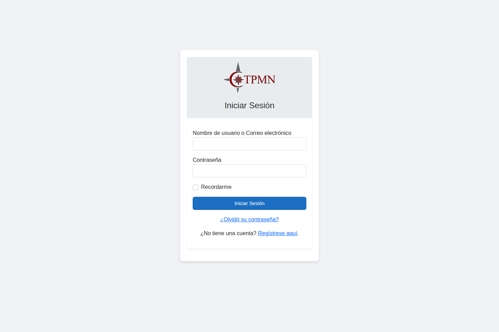
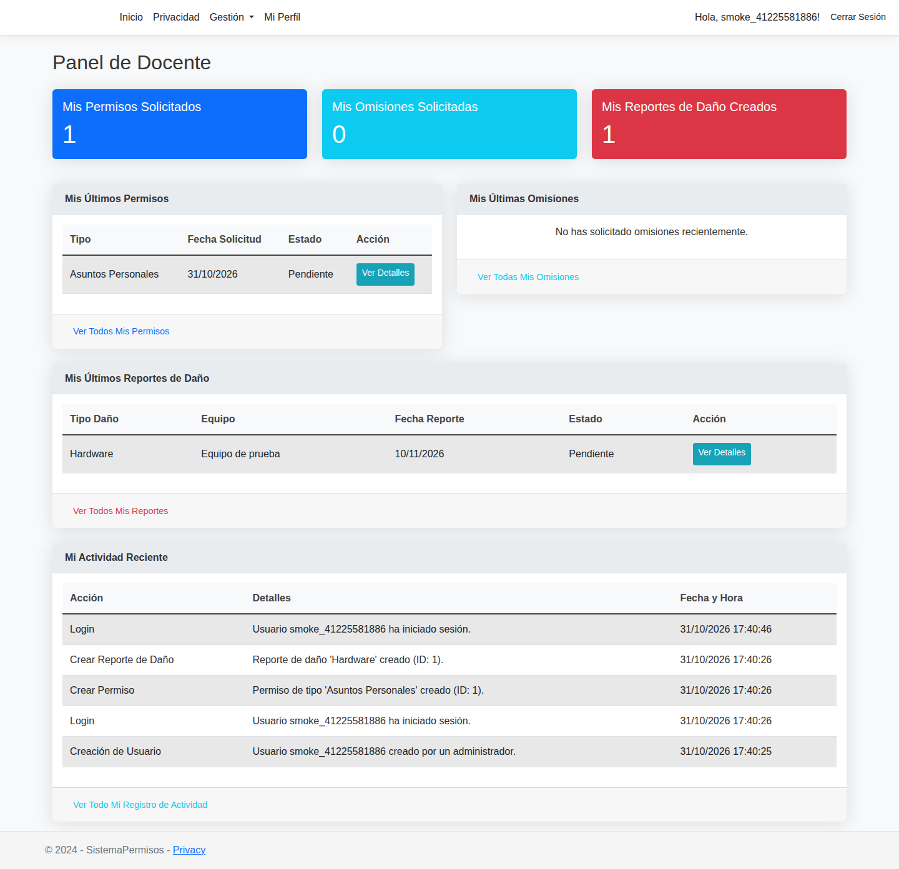
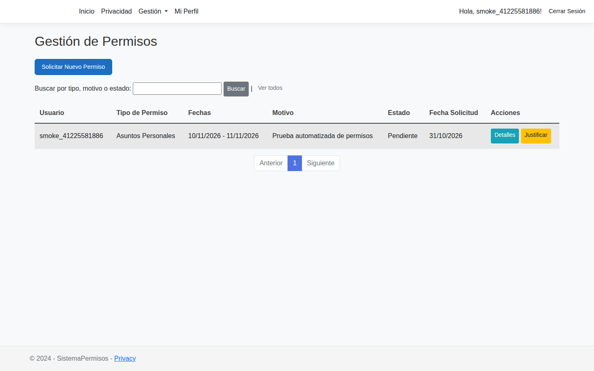

# Sistema de Gestión de Permisos

Proyecto personal de **Andrés Araya**, desarrollado con **C#, ASP.NET Core MVC (.NET 8), Entity Framework Core y SQL Server**.

## ¿Qué hace?
Aplicación web para gestionar usuarios y roles (Admin, Supervisor y Docente), solicitudes de permisos y omisiones de marca, reportes de daños, registros de auditoría y exportaciones a Excel. Las funciones dependen de la autorización de cada rol.

## Tecnologías y arquitectura
- ASP.NET Core MVC, vistas Razor, C#
- SQL Server y Entity Framework Core (migraciones)
- Separación entre controladores, servicios, repositorios, modelos y ViewModels
- Autenticación mediante cookies, autorización por roles y políticas
- EPPlus para exportación de reportes a Excel

## Instalación de desarrollo
1. Instalar .NET SDK 8 y SQL Server (o LocalDB), y clonar el repositorio.
2. Abrir `SistemaPermisos.sln` desde Visual Studio, o ejecutar `dotnet restore SistemaPermisos/SistemaPermisos.csproj`.
3. Configurar `ConnectionStrings:DefaultConnection` para una base de datos local en configuración de desarrollo, preferiblemente mediante variables de entorno o Secret Manager. No subir secretos al repositorio.
4. Ejecutar `dotnet ef database update --project SistemaPermisos` (requiere herramienta dotnet-ef) o permitir que la aplicación aplique migraciones pendientes con una base accesible.
5. Ejecutar `dotnet run --project SistemaPermisos`.

### Datos de prueba (opcional, solo desarrollo)
No se generan cuentas de demostración automáticamente. Si se desean datos de prueba, configurar `SeedData__Enabled=true` y las variables `SEED_ADMIN_PASSWORD`, `SEED_SUPERVISOR_PASSWORD` y `SEED_DOCENTE_PASSWORD` (mínimo 12 caracteres) en un entorno de **Development**. No usar credenciales de ejemplo en producción.

## Estado de pruebas

- La compilación de la aplicación **.NET 8** está verificada en GitHub Actions.
- Las **pruebas HTTP con SQL Server 2022 efímero** comprueban registro, inicio de sesión, prohibición de escalada de rol por manipulación del formulario, creación de permisos y creación de reportes.
- La base de datos desechable de estas pruebas se crea **desde el modelo actual** de Entity Framework Core (`SmokeTests:UseCurrentModelSchema=true`, solo en `Development`). **No valida las migraciones históricas**, que todavía necesitan reconciliarse con las propiedades actuales del modelo antes de actualizar instalaciones existentes.
- Las capturas de abajo son del sistema **ejecutado con datos ficticios** por GitHub Actions. No corresponden a una implementación en producción.

Verificaciones: [Compilación](https://github.com/andresarzz/permissions-management-system/actions/workflows/dotnet-build.yml) · [Pruebas SQL Server](https://github.com/andresarzz/permissions-management-system/actions/workflows/sqlserver-smoke.yml).

## Capturas de la aplicación

### Inicio de sesión

### Panel de docente

### Gestión de permisos

## Seguridad y limitaciones

Las cuentas de ejemplo solo se crean si se habilitan de forma explícita en desarrollo con contraseñas proporcionadas mediante variables de entorno. El registro público asigna el rol menos privilegiado (`Docente`) en el servidor, independientemente del rol enviado por el cliente. Antes de publicar la aplicación es necesario revisar las migraciones históricas, dependencias con avisos de seguridad, autorización completa y pruebas de usuario adicionales.

## Qué demostrar en una entrevista
- Diseño de una aplicación MVC conectada a SQL Server
- Modelado de roles y autorización
- Lógica de negocio y capas de servicios/repositorios
- Flujos de solicitudes, auditoría y exportación de datos

## Autoría
Desarrollado individualmente por Andrés Araya. Los commits pueden contener distintas identidades usadas por el mismo autor durante la realización del proyecto.
